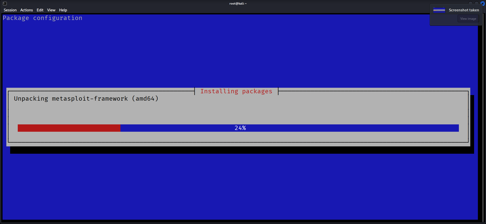
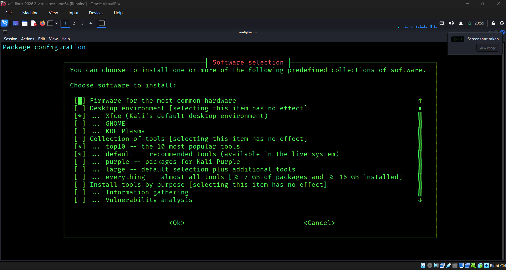

# Kali Linux Whiptail & QTerminal Pure RGB Theme (`kali-lk-gd`)

[](https://www.kali.org/)
[](https://www.gnu.org/software/bash/)
[-darkgreen)](https://github.com/lxqt/qterminal)
[](https://github.com)

A system-wide configuration script for Kali Linux that enforces a high-contrast, pure RGB aesthetic across Whiptail (Newt) TUI dialogs and QTerminal emulator sessions. 

It replaces standard muted blues, pastel terminal tones, and distracting window transparencies with pitch-black backgrounds (`#000000`), vivid saturated primary colors (pure green, red, blue, cyan, yellow), and uniform contrast optimized for CLI tools, installers, and penetration testing workflows.

---

## Features

- **System-Wide Whiptail / Newt Theming**: Deploys a customized palette (`/etc/newt/palette.rgb`) mapped to `update-alternatives`, `/etc/environment`, and `/etc/profile.d/newt_rgb.sh` for global persistence across logins and subshells.
- **Pure RGB Terminal Palette**: Generates a custom color scheme (`PureRGB.colorscheme`) utilizing strict 8-bit RGB bounds (`rgb(0,0,0)`, `rgb(255,0,0)`, `rgb(0,255,0)`, `rgb(0,0,255)`, etc.).
- **Zero Transparency / Max Contrast**: Automatically eliminates window and terminal background transparency (`TerminalTransparency=0`, `ApplicationTransparency=0`) to ensure razor-sharp text readability.
- **Multi-Version Qt Compatibility**: Supports both Qt5 and Qt6 color scheme paths (`/usr/share/qtermwidget5/color-schemes` and `/usr/share/qtermwidget6/color-schemes`).
- **Universal User Profile Provisioning**: Automatically discovers and applies configuration directly to `/root` and all user directories in `/home/*`, preserving individual user file ownership.
- **Idempotent Deployment**: Safe to execute repeatedly without duplicating configuration entries or corrupting files.

---

## Before vs. After Comparison

### Visual Comparison

| Before (Default Kali Linux) | After (Pure RGB Theme) |
| :---: | :---: |
|  |  |

### Technical Differences

| Component / Feature | Default Kali Linux | Pure RGB Theme (`kali-lk-gd`) |
| :--- | :--- | :--- |
| **Whiptail Background** | Classic blue / dull gray background | Pitch black (`black`) |
| **Whiptail Windows & Borders** | Blue background with white/cyan borders | Pitch black window with bright green borders (`brightgreen,black`) |
| **Whiptail Titles & Highlights** | Low-contrast white or cyan title bars | High-visibility bright red title (`brightred,black`) |
| **Whiptail Buttons** | Muted gray/cyan buttons | High-contrast black on bright red, active state inverted black on bright green |
| **Whiptail Progress Bars (Gauges)** | Low-contrast blue/gray fill | Vivid bright red fill (`brightred,brightred`) on bright blue track |
| **QTerminal Background** | Dark charcoal / navy blue with semi-transparency | Pure solid black (`0,0,0`) with `0%` opacity / transparency |
| **QTerminal Foreground** | Soft muted white/gray | Vibrant pure green (`0,255,0`) |
| **ANSI Color Values** | Desaturated / pastel palette | True mathematical RGB channels (e.g., Red `255,0,0`, Green `0,255,0`, Blue `0,0,255`) |
| **User Persistence** | Often per-user or session-dependent | System-wide via `/etc/environment`, `/etc/profile.d/`, and all `/home/*` directories |

---

## Installation & Setup

### Prerequisites
- Kali Linux (or Debian-based distribution)
- Root/sudo privileges
- QTerminal and Whiptail (installed by default on Kali Linux)

### Run Setup

Clone the repository and run the setup script:

```bash
git clone https://github.com/<your-username>/kali-lk-gd.git
cd kali-lk-gd
chmod +x kali-lk-gd.sh
sudo ./kali-lk-gd.sh
```

Or run directly with bash:

```bash
sudo bash kali-lk-gd.sh
```

> **Note:** The script configures `/etc/newt/palette.rgb`, system-wide environment variables, and updates `.config/qterminal.org/qterminal.ini` for `/root` and all existing users in `/home/*`.

---

## Manual Verification

After running the script, close all open QTerminal windows and open a new one. Run the following commands to verify the theme.

### 1. Whiptail Dialog Verification

```bash
# Message Box Test
whiptail --title "Pure RGB Theme" --msgbox "Whiptail dialog theme successfully verified." 10 50

# Yes/No Dialog Test
whiptail --title "Confirm Selection" --yesno "Do you like the Pure RGB theme?" 10 50

# Gauge / Progress Bar Test
for i in {1..100}; do echo $i; sleep 0.01; done | whiptail --title "RGB Gauge Test" --gauge "Testing progress meter..." 8 50 0

# Menu Box Test
whiptail --title "Menu Test" --menu "Choose an option:" 14 50 4 \
  1 "Option One" \
  2 "Option Two" \
  3 "Option Three"
```

### 2. Environment & Alternatives Check

```bash
# Verify environment variable
echo "$NEWT_COLORS_FILE"
# Output should return: /etc/newt/palette.rgb

# Verify Debian update-alternatives selection
update-alternatives --display newt-palette
```

### 3. QTerminal Configuration Check

```bash
grep -E '(colorScheme|TerminalTransparency|ApplicationTransparency)' ~/.config/qterminal.org/qterminal.ini
```

Expected output:
```ini
colorScheme=PureRGB
TerminalTransparency=0
ApplicationTransparency=0
```

---

## License

This project is licensed under the [MIT License](LICENSE).
